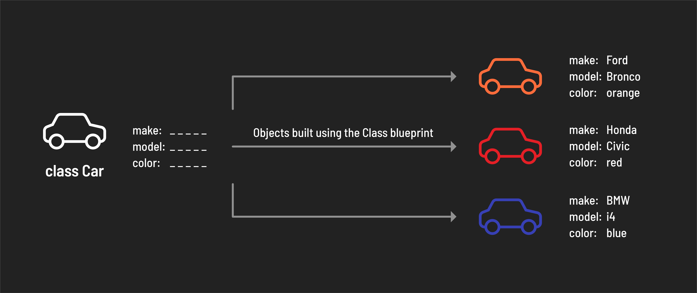
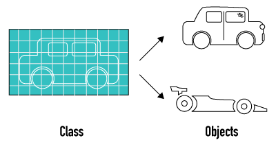

<h1>
  <span class="headline">Python Object-Oriented Programming</span>
  <span class="subhead">Classes</span>
</h1>

**Learning objective:** By the end of this lesson, students will be able to create and define Python classes, instantiate objects from these classes, and implement methods and properties within them.

| Lesson  | Duration |
| ------- | -------- |
| Classes | 85 min   |

## Classes

At their most basic, classes are templates for creating objects. These new objects are called _instances_ of that class. They specify what attributes and methods the objects will have.

A class defines characteristics (properties) and actions (methods) common to a group of objects. For instance, a `Car` class might specify properties like `make`, `model`, and `color` and a method like `drive()`. When we create individual cars (instances) from this class, each car inherits these properties and methods, allowing us to assign specific values (for example, a red Honda Civic) and perform actions (driving the car).

> 💡 Classes offer a straightforward and efficient way to create reusable parts of an application.



> 📚 An _instance_ is an object produced by a class, containing all the properties and behaviors defined by that class.

In Python, the concept that everything is treated as an object is fundamental. This means that every entity, whether it's a data structure or a user-defined data type, has attributes (properties) and behaviors (methods) defined by its class. A class in Python acts as a blueprint for creating objects (instances).

Building these classes yourself is a powerful way to grasp object-oriented programming (OOP) principles. As you work more with classes, you'll see how encapsulation protects the data within an object and how inheritance lets you extend and customize existing code.

## Classes Ensure Consistency Among Objects

All cars have things that make them a Car. Although the details might be different, every type of car has the same basic properties and methods.

- Property: A shape
- Property: A color
- Property: Number of seats
- Method: Can drive.
- Method: Can park.



Classes create consistent patterns for objects to follow. Once data starts getting complex, as in dictionaries/objects, it's all the more important to create ways to maintain consistency.

> 💡 You might also be familiar with the idea of Classes from Taxonomy in Biology. All members of a class share specific properties that mark them as belonging to that class.

## We've Been Using Classes All Along!

**Data types** are the most foundational classes in programming: String, Integer, List, Dictionary...these are all classes that Python uses under the hood.

For example, every List we've made has the same methods: `append()`, `pop()`, `prepend()`, and so on.

```python
colors = ["red", "green", "blue"]

lucky_numbers = [13, 28, 777]

# both of these are derived from the List class in Python
```

What we're going to do in this lesson is learn to create our own, custom classes. We get to decide what properties and methods the objects belonging to our classes have, and get to enforce specific rules and set default values on members of the class.

## Custom Classes for Custom Data

A class helps us ensure consistency among all the objects of a specific type.

To start, we're going to:

- Create a class
- Decide what properties the objects should have
- These properties might have default values, which we can also set up
- Create, or instantiate, objects that belong to our class

> Creating our own class is useful when we have a bunch of data that all represents the same type of information. They help us ensure consistency among all the objects of a specific type.

<br>

<div class="activity discussion">
  <h2 class="title">Classes in Applications</h2>
  <span class="minutes"></span>
</div>

Think about a standard social media application: what kinds of data might this app use Classes to represent?

<details>
<summary>✅ Click to see the answer: </summary>
<hr>

Answers should include things like Users, Posts, Comments, and so on. It's important for the application to be able to manipulate all of these things in the same way– if every user had different properties, the application would be a disaster!

</details>

## Defining a Class

To start defining a class, we simply use the `class` keyword like so:

```python
class Dog:
    # Anything indented beneath the class will define the class
```

We're going to eventually use the class like a function to create new objects:

```python
fido = Dog()
rover = Dog()
```

This would create two different objects of the Dog class.

> 💡 Note the capitalization, which is a strongly held python convention indicating when a custom Class has been created.

## Setting Up the Init Method

Then, the first part of ANY class will be the `__init__` method. This method will define the process of creating, or **_instantiating_**, a new object of the class. Within the **_init_** method, we have access to a self object that represents the individual object we're creating. It must be the first parameter in every init.

```python
class Dog:
    def __init__(self, name, age):
        self.name = name
        self.age = age

fido = Dog("Fido", 8)
```

> 💡 Note that we don't have to explicitly call the `__init__` method, i.e. we're not typing `Dog.__init__()`. Anything with double-underscores typically happens under the hood, without us having to explicitly call it. The double-underscore indicates what is known as a "magic method" pattern of Python.

<br>

<div class="activity discussion">
  <h2 class="title">Useful Patterns in the <code>Init()</code> Method</h2>
  <span class="minutes"></span>
</div>

Within the init method, we can perform all sorts of useful validating and standardizing procedures. What's the logic behind this init method?

```python
class Dog:
    def __init__(self, name, age):
        if age < 0:
            self.age = 0
        else:
            self.age = age
            self.good_dog = True
            self.name = name
```

> 💡 We're validating the age input by changing any negative numbers to 0, since negative age doesn't make sense. We're also setting a universal value, good_dog, that can't be done differently by the user. It can feel like every property MUST be declared as a parameter in the init method, but this demonstrates early how arbitrary properties can be added within the init method.

## Default Values in Methods

Just like regular functions, method parameters can be given default arguments in case the user doesn't provide one.

```python
class Dog:
    def __init__(self, name="poochie", age=0):
        self.name = name
        self.age = age
```

This means that any user-provided arguments will be applied as normal, but we get to have fall-back values if the method is called without arguments.

```python
default_dog = Dog()

# default_dog looks like: {name: "poochie", age: 0}
```

- We can set default arguments in case the user doesn’t provide one.
- This is useful when we want to be able to provide customization for specific cases, but typically use the same value.
- For example, file storage services might use a "private: false" for the default, publicly visible files users upload, but allow privacy when requested.

<br>

<div class="activity solo-exercise">
  <h2 class="title">7.1 First Class</h2>
  <span class="minutes">15 min</span>
</div>

In this exercise, we'll practice setting up a class for musicians, then create several instances of this class.

Complete the exercises in **Section 7.1** of your notebooks.

- Create a `class` for musical artists called `Musician`.
- Musicians should have `name` and `genre` properties set by parameters in the `__init__` method. The default genre should be `"Pop"`.
- Musicians should also have an `albums_sold` property that always starts at `0`.

<br>

<div class="activity group-exercise">
  <h2 class="title">7.2 House of Cards</h2>
  <span class="minutes">30 min</span>
</div>

Now, let's use classes to programmatically create a full deck of playing cards.

Complete the exercises in **Section 7.2** of your notebooks.

1. First, create a Card class with two properties:

- `Suit`
  - Possible suits are `Hearts`, `Clubs`, `Spades`, or `Diamonds`
- `Face`
  - Possible face values are `2`, `3`, `4`, `5`, `6`, `7`, `8`, `9`, `10`, `Jack`, `Queen`, `King`, `Ace`

2. Then, fill up a list called cards with all 52 combinations of the above properties.
3. Bonus: Create a `Deck` class that, when instantiated, creates the 52 cards and stores them in a property called cards.

> Remember to work one layer at a time when given complex problems like this. You'll need a loop within a loop, so consider using print statements as a way of keeping track of variables you have access to.

## Defining Methods in a Class

For every method, including the magic `__init__` method we've already been using, the first parameter must be `self`.

After that, it's up to you! Defining a method works just like defining a function.

```python
def speak(self):
    print(f"Bark! Bark! My name is {self.name}")

def count_to(self, x):
    for i in range(x):
        print("Woof!")
```

## Our Dog has Properties and Methods

```python
class Dog:
    def __init__(self, name, age):
        self.name = name
        self.age = age

    def speak(self):
        print(f"Bark! Bark! My name is {self.name}")
```

```python
poochie = Dog("poochie", 3)

poochie.speak()

# Bark! Bark! My name is poochie
```

## A Common `Error` of Python Classes

It's easy to forget to include `self` as the first parameter.

```python
def speak():     # <- self not included
    print("woof woof")
```

We get an error that's not exactly clear about what it means:

```plaintext
TypeError: speak() takes 0 positional arguments but 1 was given
```

Python automatically provides `self` to every method that gets called. If our methods aren't defined to expect this, we get the error above.

<br>

<div class="activity discussion">
  <h2 class="title">Tea Time</h2>
  <span class="minutes"></span>
</div>

What might a class for a TeaCup look like? What properties and methods could the class have?


<details>
<summary>✅ Click to see the answer: </summary>
<hr>

<ul>
<li> Some possible property answers are: A total capacity. A current amount.</li>
<li>Some possible method answers are: fill() our cup, empty() our cup, drink() some tea from our cup.</li>
</ul>

</details>

## Accessing Properties Within Methods

```python
class TeaCup:
    def __init__(self, capacity):
        self.capacity = capacity # Total ounces the cup holds.
        self.amount = 0 # Current ounces in the cup. All cups start empty!

    def fill(self):
        self.amount = self.capacity

    def empty(self):
        self.amount = 0

    def drink(self, amount_to_drink):
        self.amount -= amount_to_drink
```

- Since we have access to the self property, a lot of methods will access or modify other properties within the object.
- How we might want to enhance that last method? What if we try to drink more than the total amount remaining? Does a negative amount number make sense? If not, how can we validate against that? This should be a recurring theme among classes: the ability to validate operations when creating or modifying objects in a specific way.

<br>

<div class="activity partner-exercise">
  <h2 class="title">7.3 Getting the Band Back Together</h2>
  <span class="minutes">30 min</span>
</div>

Complete the exercises in **Section 7.3** of your notebooks.

Let's create a class for `Bands`. A `Band` should have the following properties and methods:

- `name`: String
- `members`: a list of Strings, defaults to an empty list
- `introduce_lineup()`: a method that prints all of the strings in members
- `add_member(new_member)`: a method that adds a new member to the members
- `kick_out(old_member)`: a method that removes the given member from the members list. If the members list is empty, add a disbanded property equal to True.

> As stretch goals, you could look into the property function, @property decorators, and getters and setters for validating operations on an object.
