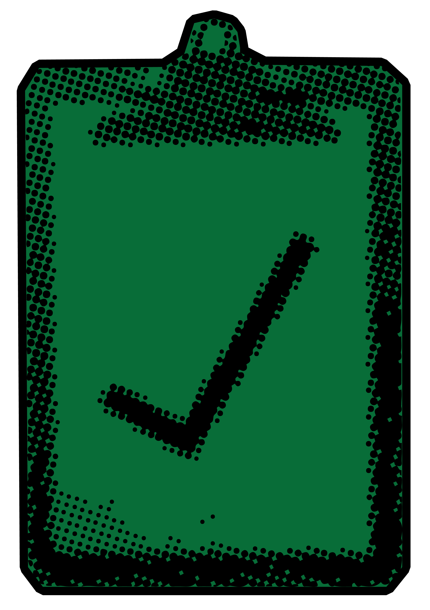

<h1>
  Python Object-Oriented Programming
  Intro to OOP
</h1>

**Learning objective:** By the end of this lesson, students will be able to explain what it means that Python is an Object-Oriented Programming language.

| Lesson       | Duration |
| ------------ | -------- |
| Intro to OOP | 10 min   |

## Our Learning Goals

- Explain what it means that Python is an Object-Oriented Programming Language.
- Define a class
- Instantiate an object from a class.
- Create classes with default instance variables.

## What We’ll Practice

This Module connects to and reinforces topics that you encountered in the pre-work.
We’re going to return to topics covered in the pre-work and build upon them:

- Objects and Classes

## What is Object-Oriented Programming?

Object-oriented programming (OOP) is a programming paradigm that uses objects to design applications and computer programs. These objects represent real-world entities, encapsulating related properties (attributes) and behaviors (methods). Python is an object-oriented programming language, and this concept is central to writing Python code.

## Objects Are Everywhere

What if we told you that every variable you've ever declared in Python has been one type all along: **objects**!

> 💡 So far, we've learned plenty of data types, both primitive and complex. Objects attempt to represent data in a way that feels familiar to how we interact with things in the real world. An object is a thing.

 

  <h2 class="title">Properties and Methods</h2>
  

All objects have **properties** and **methods**. **Methods** are functions that objects can perform, such as when a list uses `.append()` or `.pop()`.

_Let's say we're trying to represent a car as a Python object. What properties and methods would a car have? What properties would all cars have?_

✅ Click to see the answer: 

<ul>
  <li>Properties might include things like make, model, color, size, and so on. Methods might include the ability to drive, turn on, turn off, turn, and so on.</li>
  <li>Most of these properties will be relevant to all cars, and we'd like to keep things consistent among all cars so we can compare and treat them in similar ways.</li>
</ul>

